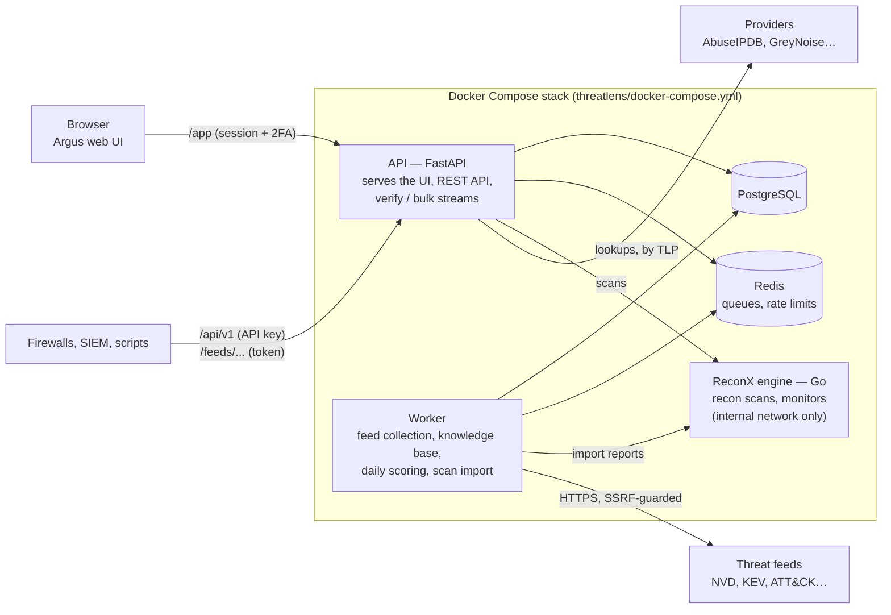

# Argus

**Self-hosted attack-surface recon and threat intelligence in one place.**

Argus answers two questions a security team asks every day:

1. **What do we expose on the internet?** It maps your domains, hosts, IPs,
   open services and software from public sources (and, only when you are
   authorised, active checks).
2. **Is this indicator bad, and what should we do about it?** It collects
   open threat-intelligence feeds, scores every IP, domain, URL, hash and CVE
   0–100 with the reasons shown, lets you verify a value against a dozen
   providers, and turns the verdict into an action: a case, a block on your
   firewalls, or "not malicious".

It runs on your own machine or server with Docker, behind one sign-in, in a
light or dark theme.

---

## What's inside

| Area | Pages | What you get |
|---|---|---|
| **Home** | Reports, Threat landscape, Assets | Live KPIs and charts you can click through to the data; what's active this week (malware, actors, exploited CVEs); a zoomable threat map of located indicator IPs; an activity calendar; every host and IP your scans found |
| **Attack surface** | New scan, Scans, Compare, Monitors | Passive scans (DNS, certificate logs, RDAP/WHOIS, archives, Shodan InternetDB…), optional authorised active scans (nmap), scan diffs, scheduled monitors with alerts |
| **Threat intel** | Verify, Bulk check, Indicators, Vulnerabilities, ATT&CK | One value or a whole file checked against your own intel and providers (AbuseIPDB, GreyNoise, VirusTotal, urlscan, RDAP, RIPEstat…), scored indicators from feeds (each with its score breakdown, threat journey from feed to action, pivots to malware and ATT&CK techniques, timeline and stored enrichment), saved views, CVEs with CISA KEV + EPSS patch priority, the MITRE ATT&CK matrix. Internal IPs are answered from your own data only |
| **Response** | Cases, Blocklist, Alerts | Investigations with evidence snapshots and Markdown/PDF reports; a blocklist that starts in monitor mode, needs a second admin to enforce, expires, never blocks your own assets, and is published to firewalls as a plain/CSV/JSON/STIX feed; alert rules to Slack, Teams, Telegram, email or a webhook (sent once, within TLP, rate-limited) |
| **Platform** | Feed catalog, Integrations, Settings, Audit log, Search | Switch feeds on/off and add your own; users and roles, two-factor sign-in (TOTP), TLP clearances, blocking policy, API keys; sharing out by TAXII 2.1, STIX, EDL/CSV/Wazuh exports, Splunk, Elastic, Sentinel and MISP (licence- and TLP-aware, see threatlens/docs/INTEGRATIONS.md); every security-relevant action is audited |

**Feeds out of the box:** URLhaus, ThreatFox, Feodo Tracker, OpenPhish, Spamhaus DROP, Tor exit nodes, AlienVault OTX, CISA KEV, NVD, EPSS, OSV,
MITRE ATT&CK. Lookup providers: AbuseIPDB, GreyNoise, VirusTotal, MalwareBazaar,
urlscan, RDAP, RIPEstat, crt.sh, DNS. Feeds and providers that need a (free) API key simply report
"skipped" until you add one.

---

## How it fits together



| Component | Language | Folder |
|---|---|---|
| **Argus web UI** | React 18, TypeScript, Tailwind, Recharts | [`web/`](web/README.md) |
| **ThreatLens** — API, worker, scoring, CLI | Python 3.12, FastAPI, SQLAlchemy, arq | [`threatlens/`](threatlens/README.md) |
| **ReconX** — recon engine and standalone CLI | Go | [`cmd/`, `internal/`, `pkg/`](docs/RECONX.md) |

---

## Quick start

**You need:** Docker Desktop (Windows/macOS) or Docker Engine (Linux), and Git.

### Windows

```powershell
git clone https://github.com/chandureddy-sec/argus.git
cd argus\threatlens
.\tl up                          # starts Docker if needed, creates .env with random secrets, builds and starts everything
.\tl user "your name" admin      # creates your sign-in (asks for a password)
```

Open **http://127.0.0.1:8000/app/** and sign in. Then go to
**Settings → Two-Factor & SSO → Set up 2FA**.

Other launcher commands: `.\tl status`, `.\tl logs`, `.\tl down` (keeps data),
`.\tl up --build` (after code changes), and any `threatlens` CLI command, e.g.
`.\tl sources` or `.\tl users list`.

### Linux / macOS

```bash
git clone https://github.com/chandureddy-sec/argus.git
cd argus/threatlens
cp .env.example .env
# edit .env: set POSTGRES_PASSWORD, and add TL_SECRET_KEY=<a long random string>
docker compose up -d --build --wait
docker compose exec api threatlens users create "your name" --role admin
```

The first feed pulls take a few minutes; the Reports page fills in as they land.
The API listens on `127.0.0.1` only. Put a TLS reverse proxy in front of it
before exposing it to a network.

---

## Configuration

| What | Where | Notes |
|---|---|---|
| Secrets and provider keys | `threatlens/.env` (never committed) | Template: [`.env.example`](threatlens/.env.example). `TL_SECRET_KEY` signs sessions and encrypts stored feed keys. Optional free keys: abuse.ch, OTX, NVD, AbuseIPDB, GreyNoise, VirusTotal, urlscan |
| Your organisation | [`threatlens/config/org_profile.yaml`](threatlens/config/org_profile.yaml) | Ships **blank**. Add your domains, IP ranges, brands and tech stack so Argus can flag brand impersonation and "CVE in your stack". Assets found by your scans always count as yours |
| Intelligence requirements | [`threatlens/config/pirs.yaml`](threatlens/config/pirs.yaml) | The questions leadership wants answered; shown on the Threat landscape |
| Scoring | [`threatlens/config/scoring.yaml`](threatlens/config/scoring.yaml) | Weights behind every 0–100 score and P1–P4 patch priority |

Apply config changes with `.\tl up --build` (or `docker compose up -d --build api worker`).

---

## Security model, in short

* **Passive first.** Scans use public sources only. Active scanning needs the
  admin role *and* an explicit "I am authorised" confirmation, recorded with
  your name in the audit log.
* **Accounts.** Roles (viewer / analyst / admin), two-factor sign-in with
  one-time codes, sessions bound to the password. A lost authenticator is reset
  with `threatlens users reset-2fa NAME`.
* **TLP everywhere.** Every indicator, case and lookup carries a Traffic Light
  Protocol marking; users only see what their clearance allows, and stricter
  markings are never sent to public providers.
* **Blocking safely.** Monitor first, a second admin to enforce, automatic
  expiry, and a never-block list (your assets, private ranges, public DNS
  resolvers) checked on every block and every export.
* **Hardened fetching.** Every outbound request goes through one client that
  refuses private addresses (SSRF), caps response sizes and retries politely.
* **Internal addresses stay internal.** Private IPs are never sent to
  providers; Verify answers them from your own data.

Details: [threat model](threatlens/docs/THREAT_MODEL.md) and the
[architecture decision records](threatlens/docs/adr/).

---

## Development

```bash
# Python (ThreatLens): tests, lint, types
cd threatlens
uv sync
uv run pytest -q
uv run ruff check src tests && uv run ruff format --check src tests && uv run mypy

# Go (ReconX)
go test ./...

# Web UI
cd web
npm install
npm run build        # or: npm run dev
```

Tests run against a synthetic "Example Corp" profile in
`threatlens/tests/fixtures/`, never against your real `config/`.

---

## Documentation

* [ReconX — the recon engine and standalone CLI](docs/RECONX.md)
* [ThreatLens — API, CLI and API examples](threatlens/README.md)
* [Web UI notes](web/README.md)
* [Data sources](threatlens/docs/SOURCES.md) · [Data model](threatlens/docs/DATA_MODEL.md) · [Threat model](threatlens/docs/THREAT_MODEL.md)
* [Architecture decisions (ADRs)](threatlens/docs/adr/) · [Progress log](threatlens/docs/PROGRESS.md)

---

## Status

Private project, actively developed. All rights reserved by the author.
