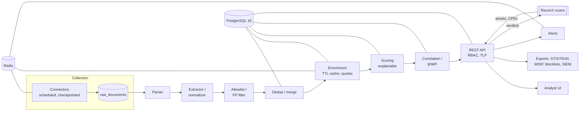

# ThreatLens — Plan

Source spec: [`PROMPT.md`](PROMPT.md). This plan records how it is built here,
including where it deliberately differs (each difference has an ADR).
Written 2026-10-08.

## 1. Context

ThreatLens lives in `threatlens/` inside the ReconX repository (ADR 0002).
ReconX is a Go attack-surface tool: it discovers *our* domains, hosts, IPs and
the technologies running on them. ThreatLens is a Python threat intelligence
platform: it collects *external* threat data. The two are linked:

* **ReconX → ThreatLens:** ReconX sends the assets it discovers (hosts, IPs,
  observed CPEs) to ThreatLens, which answers "is any of this known-bad or
  exposed to a known-exploited vulnerability?" ReconX shows the verdicts in a
  Threat Intel tab and alerts on them through its monitors.
* **ThreatLens ← ReconX:** ReconX scan results can seed the org profile's
  assets and *observed* tech stack, so PIR matching uses what is actually
  deployed, not only a hand-written list.

## 2. Architecture

Processes: `api` (FastAPI/uvicorn), `worker` (arq: connectors, enrichment,
expiry jobs), `migrate` (one-shot Alembic), `db`, `redis`. Single-host Docker
Compose first; nothing prevents splitting later.

Every outbound HTTP request goes through one hardened client (Phase 1): SSRF
guard (private/loopback/link-local/metadata ranges, re-checked after each
redirect and after DNS resolution), size and time limits, retries with
backoff + jitter, ETag/If-Modified-Since, raw-response archive.

## 3. Assumptions

* Single organization per deployment (multi-tenant is out of scope).
* Free/community tiers only; any paid service needs explicit approval first.
* Development on Windows 11 with Docker Desktop; CI and production on Linux.
* Python 3.12 (dev pinned to match the container image).
* Collection volume: tens of thousands of indicators per day — Postgres with
  sensible indexes handles this without OpenSearch or Neo4j.

## 4. Changes to the spec (ADRs)

| # | Change | Why |
|---|---|---|
| 0001 | Stack as specified, plus **uv** for packaging/locking, **arq** for jobs | uv gives a reproducible lock and fast CI; arq is small and asyncio-native (it is in maintenance mode — revisit if it blocks us). |
| 0002 | **Monorepo** (`threatlens/` in the ReconX repo) and a **ReconX link** phase (3b) | Requested; the asset↔threat join is where both tools gain the most. |
| — | **API auth + RBAC moves to Phase 1** (spec leaves it unscheduled) | Phase 1 adds the first data endpoints; they must not ship unauthenticated. |
| — | **Corroboration counts independent upstreams**, via an `upstream` lineage field on sources | Mirrors and re-publishers of one feed must not look like two confirmations. |
| — | **KEV is a non-decaying floor** in the vulnerability model | A KEV entry stays exploited; time doesn't make it safe. |
| — | **Per-source licence flags block exports** (e.g. VirusTotal's free API is non-commercial; abuse.ch and OpenPhish free tiers are non-commercial; Spamhaus DROP may not be redistributed) | The spec requires licence-aware exports; these are the known cases to verify first. |
| — | **MaxMind GeoLite2 optional** (needs an account licence key) | Use RIPEstat/Team Cymru for ASN and add GeoLite2 only when a key is provided. |

## 5. Risk register

| Risk | Likelihood | Impact | Mitigation |
|---|---|---|---|
| Feed format or terms change (as BGPView's API disappeared under ReconX) | High | Medium | Schema-drift contract tests, per-source health, `docs/SOURCES.md` re-verification dates |
| Free-tier quotas exhausted (VirusTotal ≈ 500/day) | High | Medium | TTL cache, quota buckets in Redis, partial results with `skipped_reason` |
| Hostile feed content (XSS, log/CSV injection, huge payloads) | Medium | High | Treat as untrusted everywhere: escaping, defanging, size caps, CSV formula escaping |
| SSRF through enrichment or user-supplied URLs | Medium | High | Single hardened client, bypass test suite (redirects, DNS rebinding, decimal/octal IPs) |
| TLP leakage through an export path | Low | High | TLP enforced at the query layer, tested per sink |
| Scope creep (10 phases) | High | Medium | Stop after each phase; ship usable increments; ReconX link early (3b) |
| No Docker on the dev machine | Resolved by installing Docker Desktop | — | CI runs the full stack regardless |
| False positives from popular/CDN infrastructure | High | Medium | Allowlist engine (Tranco, CDN ranges, own assets) before scoring |

## 6. Phases

| Phase | Scope | Status |
|---|---|---|
| 0 | Foundation: layout, Compose, config, Alembic baseline, CI, pre-commit, logging, health, org profile + PIRs, threat model, ADR 0001 | code complete; Docker run pending |
| 1 | Collection + processing core; hardened HTTP client; IOC extractor; allowlist; dedup; first 5–8 connectors (verified); API keys + RBAC | **complete** (8 connectors, ADR 0003); Docker run pending |
| 2 | Knowledge base: ATT&CK, NVD/EPSS/KEV/OSV, relationship graph | **complete** (ADR 0004); Docker run pending |
| 3 | Enrichment engine (RDAP, DNS, ASN, AbuseIPDB, GreyNoise, VirusTotal, urlscan, MalwareBazaar, crt.sh); lookup + bulk enrich API | **complete** (ADR 0005, Docker verified 2026-10-10) |
| 3b | **ReconX link**: ReconX `--threatlens` sends assets, shows verdicts, monitor alert rule; ThreatLens imports ReconX scans as assets/observed CPEs | **complete** (ADR 0006, live-verified 2026-10-10) |
| 4 | Scoring, trust, TLP 2.0, feedback, expiry | **complete** (ADR 0008, Docker verified 2026-10-11) |
| 5 | Analyst UI (dashboard, IOC page, search, bulk lookup, cases) | **complete** (Argus pages, ADR 0013–0016; DEMO.md 2026-10-18) |
| 6 | Dissemination: STIX 2.1/TAXII 2.1, MISP, blocklists, SIEM integrations, alerting | planned |
| 7 | Detection engineering: Sigma/Suricata/YARA, hunt queries, Navigator, coverage gaps | planned |
| 8 | Intelligence products, brand/lookalike monitoring, guarded AI assist | planned |
| 9 | Hardening, load test, observability, backup, release v1.0.0 | planned |

Each phase ends with a stop-and-review: what was built, how to verify it,
real test/lint/type output, `docs/learn/phase-N.md`, and known limitations.
