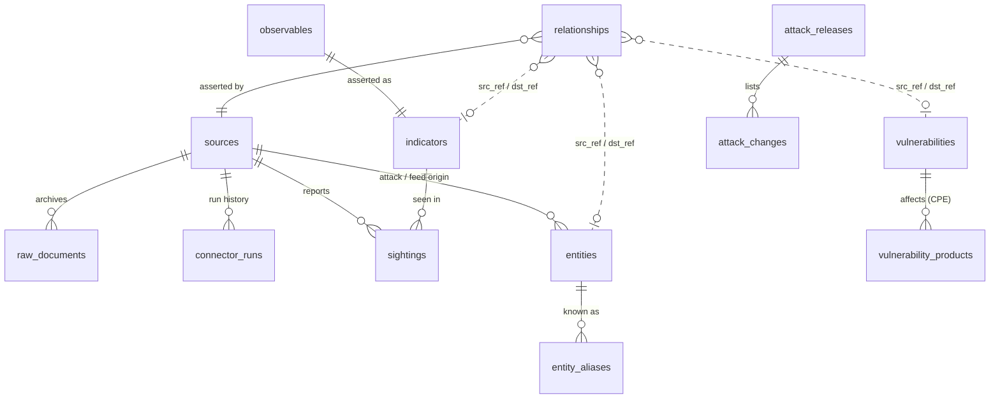

# Data model

The schema comes from Alembic migrations (`migrations/versions/`). The
SQLAlchemy models are in `src/threatlens/models.py`. This page explains how the
tables fit together and why. The decisions are in
[ADR 0003](adr/0003-collection-pipeline-and-allowlist.md) (collection) and
[ADR 0004](adr/0004-knowledge-base-and-graph.md) (knowledge base and graph).
`tests/test_api_kb.py::test_migrations_cover_every_model_column` checks that the
migrations contain every model column.

Dotted lines are references by STIX id, with no foreign key (see "Graph" below).
`allowlist_entries`, `api_keys`, `audit_log` and `app_meta` stand alone.

## Collection

| Table | One row per | Key columns | Notes |
|---|---|---|---|
| `sources` | connector | `name` (unique), licence fields, `upstream`, `reliability`, `interval_minutes`, `enabled`, `health`, `checkpoint`, `next_run_at` | Metadata is re-synced from code on every start. Runtime state (enabled, health, checkpoint) is kept. |
| `raw_documents` | distinct payload per source | `(source_id, sha256)` unique, `payload_ref`, `parse_status` | The body itself is stored gzipped under `TL_DATA_DIR`, not in the database. |
| `connector_runs` | collection attempt | `status`, `http_status`, `items_total/new/updated/rejected/allowlisted`, `error` | Raw material for health and Phase 4 feed scorecards. |

`status` values: `success`, `partial` (a knowledge source used its request budget; it
continues next run), `not_modified` (HTTP 304), `unchanged` (same hash as a parsed
document), `skipped` (missing key), `failed`. `note` says what a run did.
`too_soon` and `disabled` are returned to the caller but not stored.

## Intelligence

| Table | One row per | Key columns | Notes |
|---|---|---|---|
| `observables` | normalized value | `type`, `value`, `canonical_key` (unique), `defanged`, `first_seen`, `last_seen` | `type` uses STIX names: `ipv4-addr`, `ipv6-addr`, `ipv4-net`, `ipv6-net`, `domain-name`, `url`, `email-addr`, `file-md5/sha1/sha256`, `vulnerability`, … |
| `indicators` | observable (1:1) | `status`, `confidence` 0–100, `tlp`, `labels`, `pattern` (STIX 2.1), `allowlist_reason`, `priority_score` + `score_breakdown` (Phase 4) | The platform's own assertion about the value. |
| `sightings` | (indicator, source) | `first_seen`, `last_seen`, `times_reported`, `confidence`, `labels`, `context`, `raw_document_id` | Re-ingesting updates this row and never adds one. That is what makes collection idempotent. |

Indicator `status`: `new`, `active`, `expired`, `revoked`, `false_positive`.
The allowlist sets `false_positive` together with `allowlist_reason`, and only
reverses statuses it set itself. An analyst's decision is never overwritten.

Canonical keys put case-insensitive parts in lower case (domains, URL
scheme and host, hashes) and keep case-sensitive parts as they are (URL paths).
IPs and networks are stored in compressed canonical form.

## Allowlist

| Table | Key columns | Notes |
|---|---|---|
| `allowlist_entries` | `(kind, value, origin)` unique; `kind` ∈ domain/cidr; `effect` ∈ suppress/flag; `origin` ∈ org_profile/manual/tranco/cloudflare/fastly | Automatic origins are replaced as a whole on refresh. Only `manual` entries can be edited through the API. |

## Knowledge base (Phase 2)

| Table | One row per | Key columns | Notes |
|---|---|---|---|
| `entities` | STIX domain object | `stix_id` (unique), `type`, `name`, `external_id` (T1059.001, S0367, G0102…), `aliases`, `domains`, `platforms`, `tactics`, `is_subtechnique`, `revoked`, `deprecated`, `version`, `origin` (attack \| feed), `stix` (original object) | One table for every ATT&CK type (techniques, tactics, groups, software, campaigns, mitigations, detection objects) and for malware/actors named by feeds that ATT&CK lacks. |
| `entity_aliases` | (alias key, entity) | `alias_key` = lower-case alphanumerics of a name or alias | Resolves feed names (`QakBot`, `Qbot`) to entities. |
| `vulnerabilities` | CVE | `cve_id`, `stix_id` (both unique); NVD: `published`, `nvd_modified`, best `cvss_*` + all versions in `cvss`, `cwes`, `cpes`, `references`, `exploit_refs`, `ssvc`; KEV: `kev`, `kev_date_added`, `kev_due_date`, `kev_ransomware`; EPSS: `epss`, `epss_percentile`, `epss_date`; OSV: `osv_ids`, `packages` | A row can be a **stub** (`nvd_modified` null) until NVD answers. Each source owns its own columns. |
| `vulnerability_products` | (CVE, part, vendor, product) | from the vulnerable CPE match criteria | Join key to the org's tech stack (PIR-2) and, from Phase 3b, to ReconX's observed CPEs. |
| `attack_releases` | (domain, version) | `released`, `sha256`, `baseline`, `previous_version`, `counts`, `summary` | The first load of a domain is a baseline (nothing to diff). |
| `attack_changes` | meaningful change to one object | `change` ∈ added/modified/revoked/deprecated/restored/removed, `details.fields` | Timestamp-only updates are counted in the release summary (`touched`), not listed. |

### Graph: `relationships`

| Column | Meaning |
|---|---|
| `stix_id` (unique) | ATT&CK's relationship id, or a uuid5 of (src, type, dst, origin) for derived edges |
| `src_ref`, `rel_type`, `dst_ref` | STIX ids of an entity, a vulnerability (`vulnerability--…`) or an indicator (`indicator--…`) |
| `origin` | `attack` · `attack-mention` (CVE named in ATT&CK text) · `feed` (a feed field) · `identity` (the indicator is the CVE) |
| `scope` | ATT&CK domain for `attack` edges; feed name for `feed` edges |
| `source_id`, `confidence`, `provenance`, `first_seen`, `last_seen` | Who asserted it, how strongly, the evidence (relationship id and citations, feed field and value, or a quote) and when |

Endpoints have no foreign keys: one table and one traversal query serve every
edge kind, at the cost of possible dangling refs, which queries drop.
`indicators.stix_id` (uuid5 of the canonical key) makes indicators graph nodes.

## Enrichment (Phase 3)

| Table | One row per | Key columns | Notes |
|---|---|---|---|
| `enrichments` | (enricher, canonical key) | `enricher`, `canonical_key` (unique together), `observable_id` (nullable), `source_id` (the enricher's `sources` row), `status` ∈ ok/not_found, `mode` ∈ passive/active, `summary`, `evidence`, `raw` (≤ 256 KB), `query` (never contains a key), `http_status`, `cost`, `requested_by`, `fetched_at`, `expires_at`, `times_fetched` | The latest answer **and** the cache (fresh until `expires_at`). Keyed by canonical key so ad-hoc lookups of values that are not indicators are stored too; `observable_id` links them when one exists. Errors and skips are not stored. |

Enrichers are also `sources` rows (`kind = enricher`, `interval_minutes = 0`), for licence flags,
enable/disable and provenance; the collector never schedules them.

## Access and audit

| Table | Key columns | Notes |
|---|---|---|
| `api_keys` | `name` (unique), `prefix` (first 10 chars, for identification), `key_hash` (SHA-256, unique), `role`, `expires_at`, `revoked_at`, `last_used_at` | The plaintext key is shown once and never stored. `last_used_at` is updated at most every 5 minutes. |
| `audit_log` | `at`, `actor`, `action`, `target`, `details` | Append-only. Actions so far: `api_key.create/revoke`, `source.run/enable/disable`, `allowlist.add/delete`, `enrich.active` (every active enrichment call). |

## Indexes worth knowing
* `observables (type, last_seen)`: the indicator list and type filter.
* `sightings (source_id, last_seen)`: the `?source=` filter and feed scorecards.
* `indicators (status, updated_at)`: active-set queries and exports.
* `connector_runs (source_id, started_at)`: the run history.
* `relationships (src_ref, rel_type)` and `(dst_ref, rel_type)`: one indexed
  lookup per BFS level in each direction.
* `relationships (origin, scope)`: replacing one ATT&CK domain's edges on reload.
* `vulnerability_products (vendor, product)`: tech-stack and `?vendor=&product=` matching.
* `vulnerabilities (kev, kev_date_added)`, `(epss)`, `(cvss_score)`: the usual sort and filter orders.
* `enrichments (canonical_key)`: all answers for one observable in one read (the lookup cache hit); `(enricher, canonical_key)` unique: upsert and the backlog's freshness check; `(observable_id)`: indicator pages.
* `entities (external_id)`: ATT&CK id lookups; `entity_aliases (alias_key, entity_id)` unique: name resolution.
* The `pg_trgm` extension (baseline migration) is used for substring search
  on Postgres from Phase 5. Today `?q=` uses an escaped `LIKE`.
