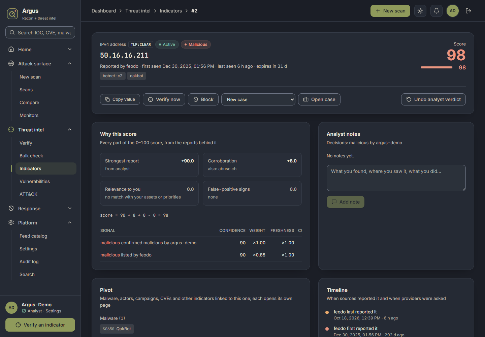
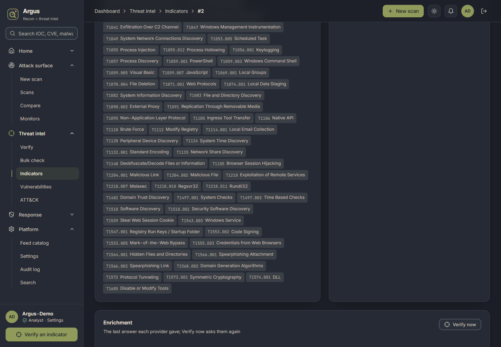
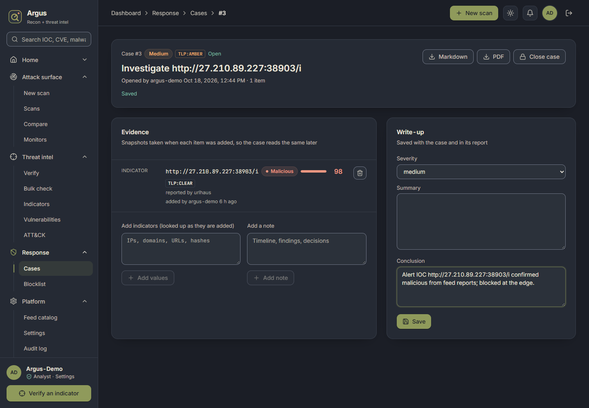

# Demo: from an alert IOC to a documented verdict

The Phase 5 acceptance test: a first-time analyst gets an IOC from a SIEM alert and, in Argus,
reaches a **documented verdict** (decision recorded, case written, report exported) in under
60 seconds.

## The walkthrough (6 actions)

| # | Analyst does | Argus shows | Clicks / keys |
|---|---|---|---|
| 1 | Pastes the alert's IOC into **Search** (or the sidebar box) and presses Enter | An exact match opens the indicator page directly. It shows the verdict pill, the 0–100 score, TLP, status, labels and who reported it, when | paste + Enter |
| 2 | Reads **Why this score** | Each part of the score (strongest report, corroboration, relevance, false-positive signs), the formula with its numbers, and each signal's confidence × weight × freshness | — |
| 3 | Glances at **Pivot** and **Timeline** | The malware family and the ATT&CK techniques it uses (each chip names who asserted it), and when each source first and last reported the IOC | — |
| 4 | Presses **Confirm malicious** | The decision is stored; the source's weight is adjusted (Phase 4 feedback) | 1 click |
| 5 | Leaves **New case** selected and presses **Open case** | A case opens titled "Investigate ‹IOC›", with the indicator and a snapshot of what Argus said about it as evidence | 1 click |
| 6 | Types a one-line **Conclusion**, presses **Save**, then **PDF** | The report downloads with the TLP marking on every page and values defanged | type + 2 clicks |





## Measured run (2026-10-18)

The walkthrough was scripted with `scripts/demo_walkthrough.py`. The script drives headless
Chrome against a throwaway Argus instance:
* SQLite;
* real public feeds collected the same day: Feodo Tracker, CISA KEV, MITRE ATT&CK 20.0, URLhaus;
* a temporary analyst account.

The alert IOC was the top item of the landscape's triage queue. The table shows when each step
finished, counted from opening the Search page:

| Step finished | Run 1: 50.16.16.211 (Feodo C2) | Run 3: URLhaus URL |
|---|---|---|
| Indicator page loaded (verdict, breakdown, pivots, timeline) | 0.5 s | 0.8 s |
| Verdict recorded | 3.6 s | 2.3 s |
| Case opened with evidence | 3.9 s | 2.5 s |
| Conclusion saved | (check too loose in run 1) | 2.7 s |
| PDF report downloaded (`200 application/pdf`, ~23 KB) | 5.0 s | 3.4 s |

**What this does and doesn't show.** These are machine times: the application's own latency
for the whole flow is about 3–5 seconds. A person also reads and types:
* about 20 s to read the verdict and breakdown;
* about 15 s to type a one-line conclusion;
* a few seconds per click.

That puts the walkthrough at roughly 45–50 seconds, inside the 60-second target. This is an
estimate from the steps above, not a timed study with real first-time users.

## Run it yourself

```powershell
# a throwaway instance (does not touch the Docker stack's data)
$env:TL_DATABASE_URL = "sqlite+aiosqlite:///./demo.db"; $env:TL_REDIS_URL = "redis://127.0.0.1:6379/5"
$env:TL_WEB_DIST = "..\web\dist"; $env:TL_DATA_DIR = ".\demo-data"
uv run threatlens init-db
uv run threatlens collect feodo cisa_kev mitre_attack urlhaus
uv run threatlens users create demo --role analyst --password-stdin   # type a password, Ctrl+Z, Enter
uv run uvicorn threatlens.api.app:create_app --factory --port 8010
# in another terminal; demo-pass.txt holds the password
uv run python scripts/demo_walkthrough.py http://127.0.0.1:8010 demo demo-pass.txt shots
```

Or do it by hand at <http://127.0.0.1:8010/app/>: sign in, open the triage queue on **Home →
Landscape**, and follow the table above.

## Known gaps seen during the run
* A URLhaus URL has no **Pivot** links. URLhaus tags (`mirai`, `Mozi`) are free-form, and
  ThreatLens only links malware that a feed names in a structured field (Feodo, ThreatFox, OTX).
  The tags still show as labels and are searchable with `tag:`.
* On SQLite, timestamps came back without a timezone, so relative times ("6 h ago") were off by
  the local UTC offset. Fixed after the run: Argus now reads a zone-less time as UTC. The Docker
  stack uses PostgreSQL (`timestamptz`) and was never affected.
* "Add to case" needed an existing open case, which added a detour to the flow. It now offers
  **New case**, which creates the case and adds the evidence in one click.
