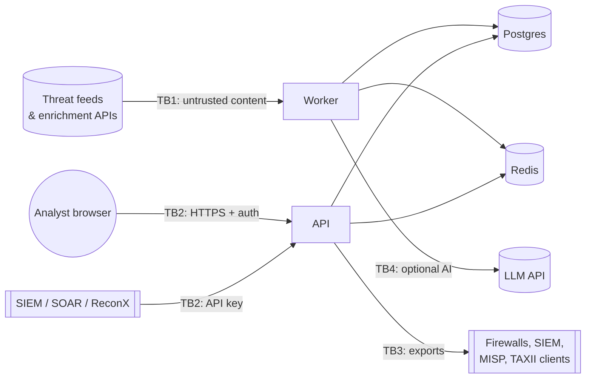

# ThreatLens threat model (STRIDE)

Version 0.1 · 2026-10-08 · Reviewed at the end of every phase.

A threat intelligence platform is itself a target: it ingests content written
by adversaries, holds data about an organization's weak points, and pushes
indicators into security controls (a poisoned blocklist can take down
production). This document lists what could go wrong and where each risk is
handled. **Status** is honest: `done` means implemented and tested in the
named phase; `planned` means not built yet.

## 1. System and trust boundaries

| Boundary | What crosses it |
|---|---|
| TB1 | Feed documents, enrichment responses — attacker-influenced text, URLs, sizes |
| TB2 | Analyst and machine API calls — authentication, authorization, input |
| TB3 | Indicators leaving the platform — TLP, licence, blast radius |
| TB4 | Untrusted text sent to a model; model output coming back |

## 2. Assets

1. Indicator store and its integrity (drives blocking decisions).
2. Org profile, PIRs and assets (a map of what to attack).
3. API keys for third-party services and for ThreatLens itself.
4. Analyst verdicts, cases and notes (may contain incident details).
5. Availability of collection and enrichment (stale intel is a silent failure).

## 3. STRIDE analysis

| ID | Threat | Component | Mitigation | Status |
|---|---|---|---|---|
| S1 | Caller impersonates an analyst or integration | API | API keys (256-bit, SHA-256 at rest, shown once, expiry/revocation) + RBAC (admin/analyst/viewer) on every data route | **done · Phase 1** (API keys); JWT for the Phase 5 UI session |
| S2 | Forged feed (DNS/TLS interception) injects indicators | Connectors | HTTPS only, certificate verification on, source pinned to its documented host | **done · Phase 1** |
| S3 | Spoofed request ID / headers poison logs | API | Request ID echoed only if it matches `[A-Za-z0-9._-]{1,64}`; otherwise generated | **done · Phase 0** |
| T1 | Malicious or wrong feed entry blocks a critical service | Pipeline, exports | Allowlist (Tranco, CDN/cloud ranges, own assets) before scoring; confidence thresholds per export; analyst FP feedback | **allowlist done · Phase 1**; thresholds/feedback Phases 4, 6 |
| T2 | SQL injection via search or filters | API, DB | SQLAlchemy parameterized queries only; no string-built SQL | **done (policy) · Phase 0**; tests in Phase 5 |
| T3 | Tampering with stored raw documents | DB | Raw documents stored with SHA-256; reading one back verifies the hash; path traversal refused | **done · Phase 1** |
| T4 | Malicious dependency or base image | Build | Locked dependencies (uv.lock), pip-audit, Trivy image scan, SBOM, gitleaks, bandit, semgrep in CI | **done · Phase 0** (CI defined; first green run pending) |
| R1 | Analyst denies changing a verdict or exporting data | API | Append-only `audit_log` (who, what, when, before/after) | planned · Phase 4 |
| R2 | Unclear where an indicator came from | Pipeline | Provenance on every sighting and graph edge (source, fetch time, raw document, evidence) | **done · Phases 1–2** (enrichment: Phase 3) |
| I1 | Secrets leak via logs, errors or reprs | All | `SecretStr` settings; log processor redacts key-like fields; readiness reports exception *type* only | **done · Phase 0** |
| I2 | TLP:AMBER/RED data reaches a viewer or external sink | API, exports | TLP 2.0 enforced in the query layer and per sink; tests attempt bypasses | planned · Phase 4 |
| I3 | Stored XSS from feed content in the UI | UI | Server-side escaping by default, no raw HTML rendering, IOCs defanged in display, strict CSP | partial · Phase 0 (CSP + headers); UI in Phase 5 |
| I4 | CSV/formula injection in exports opened in Excel | Exports | Prefix `= + - @` cells; quote all fields | planned · Phase 6 |
| I5 | Org profile reveals attack surface | Config | Profile has no secrets; access via RBAC; deploy on private network | partial · Phase 0 |
| I6 | Database/Redis exposed on the network | Infra | Compose binds ports to 127.0.0.1; services on a private network; Redis password/ACL for non-dev | partial · Phase 0 (localhost bind) |
| D1 | Huge or decompression-bomb responses exhaust memory | Connectors | Per-source size caps while streaming, unzipped-size checks (Tranco, EPSS), timeouts | **done · Phases 1–2** (ATT&CK Enterprise is parsed in memory, ≤ 128 MB cap) |
| D2 | API flooding | API | Per-key rate limits in Redis; request size limits; page size ≤ 500 | **done · Phase 1** |
| D3 | Dependency outage stalls readiness probe | API | Readiness checks run concurrently with a hard timeout (default 2 s); liveness never touches dependencies | **done · Phase 0** |
| D4 | Free-tier quota exhaustion | Enrichment | Quota buckets, TTL cache, partial results with `skipped_reason` | planned · Phase 3 |
| T5 | Poisoned knowledge: a feed names a fake or misleading malware/actor to create false links | Graph | Feed-named entities are marked `origin=feed` and attributed; ATT&CK entities win name resolution; feed-derived edges carry the feed's confidence (OTX co-mentions: 40) and the field as evidence; CVE mentions are `related-to`, never `exploits` | **done · Phase 2**; analyst merge/override in Phase 4 |
| D5 | Expensive graph queries (hub techniques, deep searches) | API, graph | `max_depth` ≤ 6, `limit` ≤ 50, bidirectional BFS with a visited-node budget (20 000) that returns `truncated`; neighbour lists capped | **done · Phase 2** |
| I7 | Licence breach: ATT&CK/EPSS/OSV data shared without required notices | API, exports | Per-source licence, redistribution and attribution flags (`/api/v1/sources`); ATT&CK copies must keep MITRE's notice | partial · Phase 2 (flags); enforced in Phase 6 exports |
| E1 | SSRF: user or feed-supplied URL reaches internal services or cloud metadata | HTTP client | Single hardened client: block private/loopback/link-local/metadata ranges, re-validate after DNS resolution and each redirect, reject non-canonical IP forms | **done · Phase 1** |
| E2 | Container breakout or privilege escalation | Infra | Non-root user, read-only root FS, `cap_drop: ALL`, `no-new-privileges` | **done · Phase 0** |
| E3 | YAML deserialization executes code | Config | `yaml.safe_load` only; test proves `!!python/object` tags are rejected | **done · Phase 0** |
| E4 | Prompt injection makes the AI module act or fabricate IOCs | AI | Model has no tools or side effects; feed text delimited as data; every extracted IOC must appear literally in the source; analyst approval; injection test suite | planned · Phase 8 |

## 4. OWASP API Security Top 10 (2023) mapping

| Risk | Where handled |
|---|---|
| API1 Broken object level authorization | RBAC + TLP checks per object (S1, I2) |
| API2 Broken authentication | API keys + JWT (S1) |
| API3 Broken object property level authorization | Pydantic response models; no ORM objects returned directly |
| API4 Unrestricted resource consumption | Rate limits, pagination caps, bulk-lookup caps (D2) |
| API5 Broken function level authorization | Role required per route (S1) |
| API6 Unrestricted access to sensitive business flows | Export and bulk-enrich quotas per key (D2, D4) |
| API7 SSRF | Hardened HTTP client (E1) |
| API8 Security misconfiguration | Security headers, docs off in prod, CI scanners (S3, T4) |
| API9 Improper inventory management | Versioned `/api/v1`, OpenAPI published only outside prod |
| API10 Unsafe consumption of APIs | All third-party responses validated, size-capped and treated as untrusted (TB1, D1) |

## 5. OWASP ASVS 4.0 coverage (target level 2)

| Chapter | Phase |
|---|---|
| V1 Architecture | this document, ADRs (Phase 0) |
| V2/V3 Authentication & session | Phase 1 (API keys), Phase 5 (UI sessions/JWT) |
| V4 Access control | Phases 1, 4 (RBAC, TLP) |
| V5 Validation & encoding | Phases 0–1 (profile validation, extractor), 5 (UI encoding) |
| V7 Errors & logging | Phase 0 (structured logs, redaction) |
| V8 Data protection | Phase 4 (TLP), Phase 9 (backups) |
| V10 Malicious code / V14 Configuration | Phase 0 (CI scanners, container hardening) |
| V12 Files & resources | Phase 1 (SSRF, size caps) |
| V13 API | Phases 1–6 |

## 6. Residual risks (accepted for now)
* The dev stack uses Redis without a password on a localhost-only port.
* Phase 0 has no authentication because it exposes only health endpoints.
